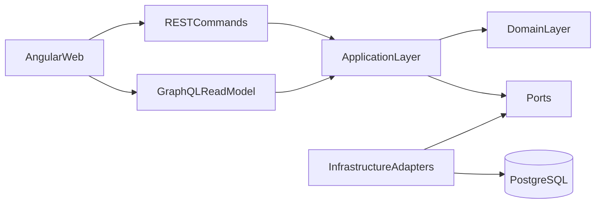

# Архитектура

## Стиль

Первоначальная архитектура — модульный монолит. Каждый bounded context владеет своими application services, доменной моделью и persistence adapter. Transport-слой вызывает application API и не содержит бизнес-правил.

Допустимое направление зависимостей: `transport → application → domain`. Infrastructure реализует порты application/domain; внутренние детали одного контекста не импортируются другим контекстом.

## Bounded contexts

- Identity и Organizations — пользователи, membership, роли и tenant boundary.
- Catalog и Pricing — товары, варианты, категории и прайс-листы.
- Procurement — поставщики и закупки.
- Inventory — склады, ячейки, движения, остатки и резервы.
- Orders — клиенты, продажи и жизненный цикл заказа.
- Fulfillment — комплектация, отправления и tracking.
- Billing — счета, платежи и возвраты денег.
- Returns — возвраты товара и решения по ним.
- Notifications — пользовательские уведомления.
- Analytics — read models и отчёты.
- Audit — неизменяемый журнал чувствительных действий.

## Интеграция

PostgreSQL является источником истины. Изменение агрегата и outbox event записываются одной транзакцией. RabbitMQ используется для at-least-once доставки; consumers обязаны быть идемпотентными. Redis не хранит единственную копию денежных данных или остатков.

REST обслуживает команды и интеграции, GraphQL — составные read models, WebSocket — двунаправленные live-сценарии, SSE — прогресс длительных серверных операций.

## Эволюция

Контекст выделяется в сервис только при наличии измеримой причины: независимое масштабирование, изоляция отказов, отдельный release cadence или ownership. Публичные контракты и события версионируются до физического разделения.
