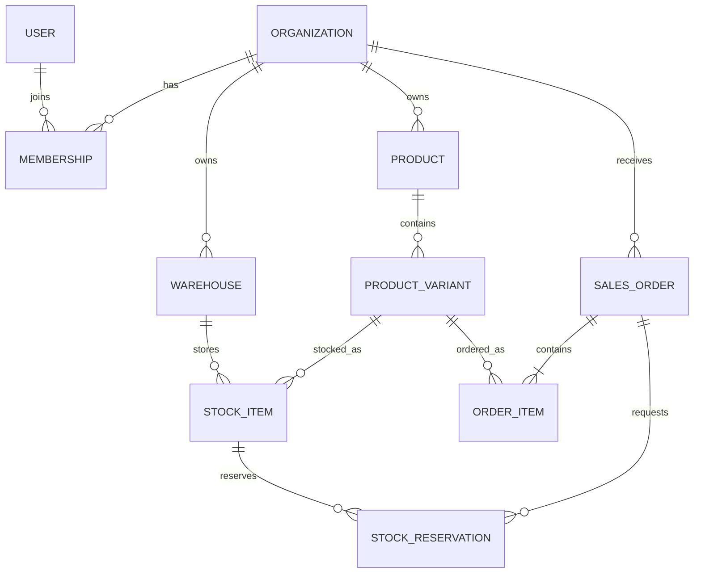

# Концептуальная модель данных

На первом этапе фиксируется модель и соглашения, но бизнес-таблицы не создаются раньше соответствующих функциональных модулей.

## Соглашения

- Первичные ключи — UUID, генерируемые приложением или PostgreSQL.
- Tenant-owned таблицы содержат `organization_id`; уникальность и индексы включают tenant key.
- Время хранится как `timestamptz` в UTC, отображение выполняется в часовой зоне пользователя.
- Деньги хранятся как `numeric` и ISO 4217 currency; floating point запрещён.
- Имена таблиц и колонок используют `snake_case`, TypeScript-свойства — `camelCase`.
- Soft delete применяется только там, где восстановление или история имеют продуктовую ценность.
- Исторические и audit-записи append-only; изменение бизнес-статуса сохраняется отдельно от текущего snapshot.
- Внешние ключи и поведение `ON DELETE` задаются явно.

## Индексы и конкурентность

Индекс добавляется под известный запрос и проверяется через `EXPLAIN (ANALYZE, BUFFERS)`. Планируются composite B-tree, partial, covering, GIN и BRIN индексы.

Резервирование остатков использует короткие транзакции и row-level locks в фиксированном порядке. Outbox workers используют `FOR UPDATE SKIP LOCKED`. Редактирование агрегатов защищается optimistic version; deadlock и serialization failures повторяются ограниченное число раз.
