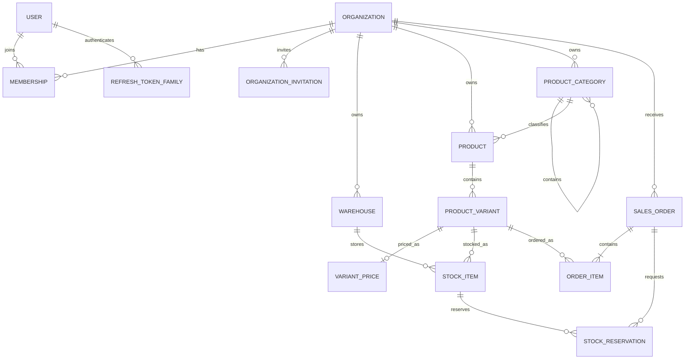

# Концептуальная модель данных

Migration `IdentityOrganizations` создаёт первые таблицы: `users`, `organizations`, `organization_memberships`, `refresh_token_families` и `organization_invitations`. Остальные бизнес-таблицы появляются только вместе с соответствующими функциональными модулями.

## Соглашения

- Первичные ключи — UUID, генерируемые приложением или PostgreSQL.
- Tenant-owned таблицы содержат `organization_id`; уникальность и индексы включают tenant key.
- Время хранится как `timestamptz` в UTC, отображение выполняется в часовой зоне пользователя.
- Деньги хранятся как `numeric` и ISO 4217 currency; floating point запрещён.
- Имена таблиц и колонок используют `snake_case`, TypeScript-свойства — `camelCase`.
- Soft delete применяется только там, где восстановление или история имеют продуктовую ценность.
- Исторические и audit-записи append-only; изменение бизнес-статуса сохраняется отдельно от текущего snapshot.
- Внешние ключи и поведение `ON DELETE` задаются явно.

## Catalog и Pricing MVP

- `organizations.default_currency` хранит одну ISO 4217 валюту организации; существующие записи
  получают `USD`. Валюта изменяется только до появления первой цены.
- `product_categories` образуют tenant-scoped дерево через nullable `parent_id`. Slug уникален
  среди siblings одной организации.
- `products` принадлежат организации и опционально категории. `product_variants` принадлежат
  товару, а SKU уникален в пределах организации.
- Products и variants используют статус `active | archived` и optimistic `version`.
- `variant_prices` содержит не более одной текущей цены варианта. `amount` хранится как
  `numeric(19,4)` и передаётся через API строкой; currency берётся из организации.

## Индексы и конкурентность

Индекс добавляется под известный запрос и проверяется через `EXPLAIN (ANALYZE, BUFFERS)`. Планируются composite B-tree, partial, covering, GIN и BRIN индексы.

Резервирование остатков использует короткие транзакции и row-level locks в фиксированном порядке. Outbox workers используют `FOR UPDATE SKIP LOCKED`. Редактирование агрегатов защищается optimistic version; deadlock и serialization failures повторяются ограниченное число раз.
